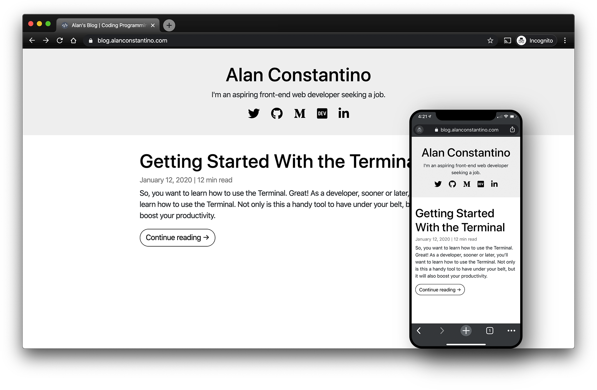
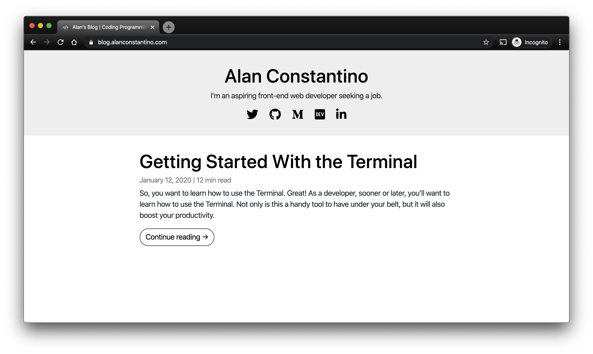
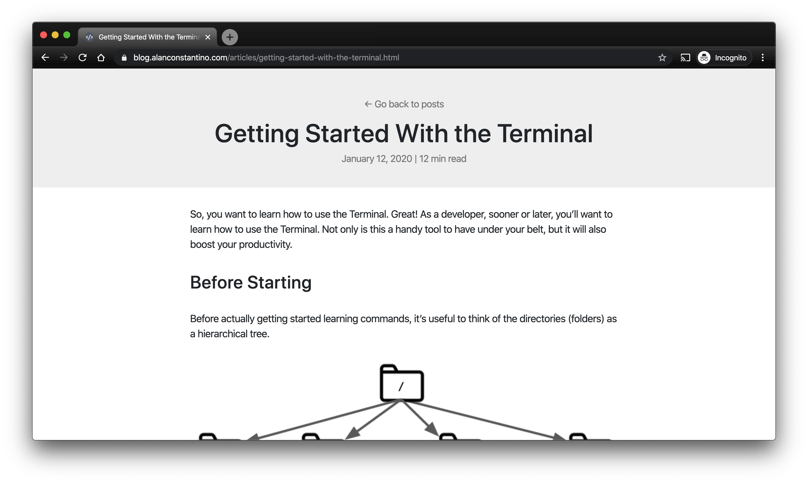
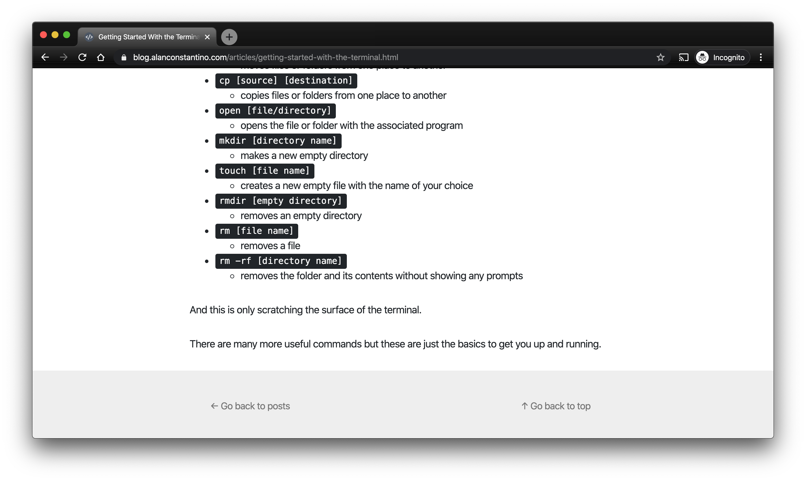

# [Personal-blog](https://blog.alanjc.com/)

This is my [personal blog](https://blog.alanjc.com/).
The topics cover coding, web development, and other work notes.

The public site is static HTML and CSS.
Posts start as Markdown in `content/posts/`.
Run the Python build to create the HTML files.

Design notes:

- Inspired by the [Evermore template](https://webflow.com/templates/html/evermore-blog-website-template)
- Icons from [Font Awesome](https://fontawesome.com/icons)
- Layout base: [Skeleton.css](http://getskeleton.com)

## Write and build

See the full guide:

[docs/how-to-write-an-article.md](docs/how-to-write-an-article.md)

Short form:

1. Add a Markdown file under `content/posts/`.
2. Fill the front matter fields (`title`, `date`, `slug`, `description`).
3. Run `python3 scripts/build.py`.
4. Check the generated HTML.
5. Commit the Markdown source and the generated files.

## Layout

| Path | Role |
|------|------|
| `content/posts/` | Markdown source for posts |
| `templates/` | HTML shells for the build |
| `scripts/build.py` | Site build |
| `scripts/vendor/markdown2.py` | Vendored Markdown library |
| `articles/` | Generated post pages |
| `tags/` | Generated tag pages |
| `index.html` | Home page (build fills the post list) |
| `rss.xml` | Generated RSS feed |
| `donate.html` | Static donate page |
| `css/`, `images/` | Static assets |

## Images

_Images are out of date._

